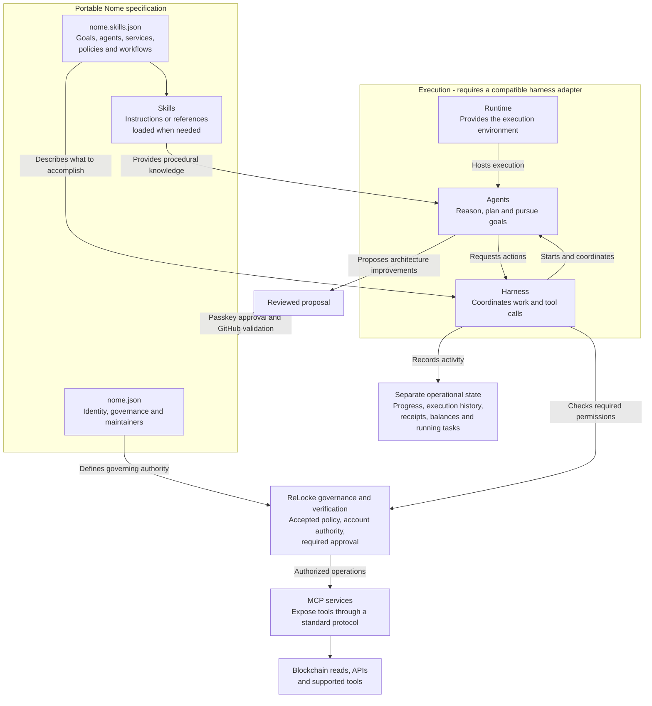

# Nome

A Nome is a programmable orchestration layer organised around a set of goals. It defines the governance, rules, skills, agents, blockchain networks, MCP services, and resources required to achieve those goals.

This Nome develops the shared model for creating and improving other Nomes. The specification below is a starting point for development. It separates intended architecture from operational state and distinguishes working infrastructure from planned execution capabilities.

## Technical architecture

The Nome describes what should happen. A compatible harness coordinates agents and tools within the declared constraints and the host's enforced permissions.

The diagram describes the intended integration. Declaring a capability does not install it, prove its availability or authorize its execution.

| Component | Responsibility |
| --- | --- |
| Nome | Defines purpose, goals, governance and intended architecture. |
| Agent | Reasons about objectives, proposes plans and performs authorized tasks. |
| Skill | Supplies reusable procedural knowledge, inline or through an instruction reference such as `SKILL.md`. |
| Harness | Coordinates agents, context, workflow steps, tool calls and execution records. |
| Runtime | Provides the environment in which agents and supporting code execute. |
| MCP service | Exposes tools through a standard protocol. It does not itself grant permission. |
| ReLocke | Enforces governance and verification for ReLocke-managed operations and coordinates supported infrastructure. |

## Portable specification and separate state

`nome.json` retains the Nome's stable identity, accepted maintainer policy, repository information, discovery metadata and declared files.

The proposed companion `nome.skills.json` describes **intent**: purpose, goals, agents, skills, tools, MCP services, blockchain references, resource requirements, policies and workflows. Components have stable identifiers and references. A simple Nome can start with its name and purpose; advanced capabilities are optional.

Operational state is stored separately by the harness or service responsible for it:

- Goal progress and execution history.
- Running tasks and execution results.
- Transaction receipts and observed balances.
- Observations about which capabilities are actually available.

The same specification can therefore be read by different compatible harnesses without carrying another installation's running tasks or stale balances. Credentials, private keys and authentication secrets belong in the host's protected storage, never in public Nome files.

## From a goal to an operation

1. Read the accepted specification and understand its purpose and goals.
2. Discover relevant workflows, agents and capabilities.
3. Load only the skill instructions needed for the task.
4. Resolve available services and determine required permissions and approvals.
5. Execute authorized operations through supported runtimes and tools.
6. Record results and goal progress in separate operational state.

Workflow inspection is not execution. For ReLocke-managed writes, the backend must verify the applicable accepted policy, current account authority and required approval for the exact operation. A reference to a blockchain account, MCP service or another Nome cannot override those checks.

## Developing and refining a Nome

Begin with the problem, desired outcome, proposed approach and constraints. Choose the Nome's name explicitly. Discuss and stress-test ideas in plain English; inspect technical files when needed.

An agent can inspect the architecture, identify missing capabilities and propose improvements as objectives evolve. Those proposals remain separate from accepted architecture until reviewed and adopted.

For this Nome, the current accepted maintainer is **`vaulta:rloc@active`**, as declared in [`nome.json`](nome.json). Verified contributors can propose changes; acceptance requires the current maintainer policy, passkey approval and GitHub validation. A signature proves attribution and authorization, not the truth of an argument.

Discussions in the ReLocke browser are stored locally across refreshes. Only the content explicitly selected for publication is included in a public contribution. Accepted documents provide shared context for subsequent conversations.

## Implementation status

Status at 29 October 2026:

| Area | Status |
| --- | --- |
| Public Nome pages, discovery metadata, chat and signed contribution review | Existing ReLocke functionality. |
| Versioned architecture schema, reference validation, progressive HTTP/MCP inspection and architecture review UI | Implemented and tested locally; rollout pending. |
| Public adoption of `nome.skills.json` by this Nome | Requires a reviewed, signed change; this README alone does not adopt that file. |
| General workflow execution, operational-state persistence adapters and automated agent coordination | Extension points for further development. |
| Cross-Nome capability execution | Proposed interoperability; requires explicit trust and authorization. |

The GitHub validator must support the new architecture format before the application begins publishing it. Existing Nomes remain valid without the companion specification.

## Project context

- [Manifest](nome.json): accepted identity, authority and project declarations.
- [Context](CONTEXT.md): shared reasoning and decisions.
- [References](REFERENCES.md): supporting sources and capability references.
- [Conversation](CONVERSATION.md): discussion conventions.
- [Roadmap](ROADMAP.md): development direction.
- [Discovery](DISCOVERY.md): metadata and indexing conventions.
- [Agent orientation](AGENTS.md): how to interpret this project.

Other Nomes may reference this framework at an exact repository revision and adopt later revisions through review. References remain context, not automatic trust or execution authority.
